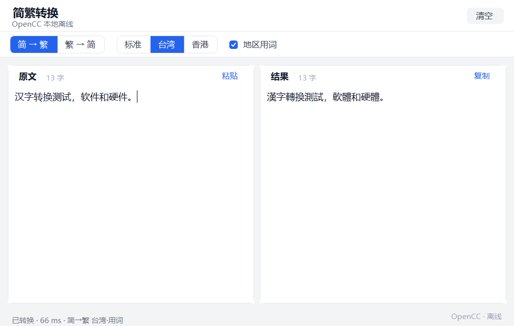

# 简繁转换（JianFanConverter）

**中文** | [English](README.en.md)

一个本地离线的简体 ↔ 繁体中文转换小工具。左侧粘贴/输入原文，右侧实时显示转换结果，支持 OpenCC 标准、台湾正体、香港繁体及地区用词转换，基于 OpenCC 引擎，全程本地运行，无任何网络请求。



**自带 OpenCC 引擎**：运行和构建都只依赖本目录内的文件，完全离线，可独立分发或迁移。运行时资产在编译时内嵌进 exe，分发只需要一个文件。

## 独立性

| 场景 | 依赖 |
| --- | --- |
| 运行 `dist\JianFanConverter.exe` | 只有这 **1 个 exe**；.NET Framework 4.8（Win10/11 自带）；win-x64 |
| 重新构建 `build.ps1` | `src\windows\Program.cs` + `vendor\opencc\` 内的引擎文件 + 系统自带 `csc.exe` |

- 单个 `dist\JianFanConverter.exe` 可以直接拷到任意位置（或另一台 Win10/11 x64 电脑）运行，不需要附带其它文件。
- `vendor\opencc\` 是项目自带的 OpenCC 引擎副本（`opencc.dll` + 词典 + 许可），`build.ps1` 只从这里读取并作为资源嵌入，**不读取任何外部安装目录，也不访问网络**。
- OpenCC 运行时资产的来源与授权见 `vendor\opencc\NOTICE.txt`；项目内不含任何 GPL 代码。

## 功能

- 双向转换：`简 → 繁`、`繁 → 简`，点击顶部分段开关切换
- 繁体目标可选：`标准`、`台湾`、`香港`；可再开启「地区用词」做本地化用词转换（台湾：软件 → 軟體；香港：打印机 → 打印機）
- 左侧输入实时转换（200 ms 防抖），右侧结果可编辑、可部分复制
- `粘贴`：用剪贴板文本替换左侧内容；`复制`：复制右侧结果；`清空`：清空两侧
- 实时字数统计、转换耗时状态提示
- 内容不满一屏时自动隐藏垂直滚动条，超出才显示
- 输入为空时显示占位提示；切换方向时保留原文并立即重新转换

## 运行

从发行版下载 zip 解压后，双击 `JianFanConverter.exe`。压缩包里共 3 个文件：

```
JianFanConverter.exe     主程序
LICENSE.txt              本程序的 MIT 许可
THIRD-PARTY-NOTICES.txt  OpenCC 的 Apache-2.0 许可与来源说明
```

后两个是许可证要求的伴随声明，删掉不影响运行，但重新分发时应随包保留。从源码构建的话，直接运行 `dist\JianFanConverter.exe`。

要求：Windows 10/11 **x64**，.NET Framework 4.8 运行时（Win10/11 自带）。运行时只需要那一个 exe：`opencc.dll`、10 个转换配置（标准 / 台湾 / 香港 / 地区用词）与 19 个 `.ocd2` 词典文件已经在编译时内嵌进程序里，**不需要**放在 exe 旁边。

首次运行时程序会把内置的 OpenCC 运行时释放到 `%LOCALAPPDATA%\JianFanConv\runtime-r2\`（该目录不可写时退到 `%TEMP%\JianFanConv\runtime-r2\`），之后的启动直接复用已释放的文件。若释放失败或文件不可用，程序会用中文弹窗说明原因。

> 从仓库克隆的代码不包含 `dist\`（构建产物不入库），请先按下一节构建。

首次启动 Windows SmartScreen 可能提示未知发布者（exe 没有代码签名），点「更多信息 → 仍要运行」即可。

## 构建

无需安装任何 SDK / NuGet，使用系统自带的 .NET Framework 编译器：

```powershell
powershell -ExecutionPolicy Bypass -File build.ps1
```

脚本会：清理并重建 `dist\` → 校验项目内 `vendor\opencc\` 的 7 个 OpenCC 运行时文件并**以 `/resource` 编译为内嵌资源**（`JianFanConverter.Runtime.<文件名>`）→ 用 System.Drawing 生成临时图标 `dist\app.ico` 供 `/win32icon` 使用（失败则跳过，不阻塞构建；编译后删除）→ 调用系统自带的 `%WINDIR%\Microsoft.NET\Framework64\v4.0.30319\csc.exe` 编译（`/target:winexe /platform:x64 /codepage:65001`）。

构建完成后 `dist\` 里只有 `JianFanConverter.exe` 一个文件。

## macOS 版（开发中）

macOS 版是原生 SwiftUI 应用：OpenCC 1.4.2 **静态链入主程序**，配置与词典放在 `.app/Contents/Resources/opencc/`，没有运行时释放、没有落盘缓存，产物是 arm64 + x86_64 通用 `.app`。

构建（**只能在 Mac 上执行**）。前置：`xcode-select --install`、`brew install cmake`，并把 OpenCC 1.4.2 源码放到 `vendor/opencc-src/`（只需一次）：

```bash
git clone --branch ver.1.4.2 --depth 1 https://github.com/BYVoid/OpenCC.git vendor/opencc-src

# 一次性：构建 universal OpenCC 静态库
bash src/macos/scripts/build-opencc.sh

# 构建 .app；版本号默认取最新 tag，可用 --version 覆盖
bash src/macos/scripts/build-app.sh
bash src/macos/scripts/build-app.sh --version 1.2.0
```

产物：`dist-macos/JianFanConverter.app` 与 `dist-macos/JianFanConverter-v<版本>-macos-universal.zip`。

要求 macOS 14+。产物是 `.app`，直接拖进「应用程序」即可，没有安装器。

### 首次打开被 Gatekeeper 拦截？

应用是 **ad-hoc 签名、未做 Apple 公证**（公证需要付费的 Developer ID 证书），所以 macOS 会按设计拒绝启动，弹窗提示「Apple 无法验证 "JianFanConverter.app" 是否包含可能危害 Mac 安全或泄漏隐私的恶意软件」。**这不是文件损坏，也不是下载不完整**——这是未公证应用的预期行为，解压后 `codesign --verify --strict` 能通过。

> macOS 15 起 Apple 已取消「右键 → 打开」这条绕过路径，网上多数旧教程在 Sequoia 及之后不再有效。

任选一种放行：

**方式一：命令行（最快）**

```bash
xattr -dr com.apple.quarantine /Applications/JianFanConverter.app
open /Applications/JianFanConverter.app
```

`xattr -dr com.apple.quarantine` 只删除「来自网络下载」的隔离标记，不改动应用内容。

**方式二：系统设置**

1. 双击应用，看到拦截弹窗时点「完成」（**不要**点「移到废纸篓」）
2. 打开「系统设置 → 隐私与安全性」，滚到底部
3. 在「已阻止使用 "JianFanConverter.app"」旁点「仍要打开」，输入登录密码
4. 再在弹窗里点「打开」

如果已经点了「移到废纸篓」，先在废纸篓里右键 → 「放回原处」，再按上面操作。

**方式三：自己构建**

按上面的「构建」一节自行编译，产物可以直接运行，不需要处理隔离标记。

放行后 `spctl -a` 仍会显示 `rejected`，因为它只认 Apple 签发的 Developer ID 签名；这不影响运行。

引擎级自检（不启动 GUI）：

```bash
bash src/macos/scripts/test-engine.sh
bash src/macos/scripts/smoke.sh
```

## 自检

构建后可以跑 UI 冒烟脚本（自动构建、冷启动、切换全部转换模式，并验证复制/清空）：

```powershell
powershell -ExecutionPolicy Bypass -File tools\smoke.ps1
```

脚本用真实鼠标点击「复制 / 清空」，会短暂把窗口置前并移动光标，结束后恢复。无法使用真实鼠标的环境（如部分远程/无桌面会话）加 `-SkipInteractive`；已有构建产物时加 `-SkipBuild`。

## 修改指南

源码只有一个文件 `src\windows\Program.cs`（约 1360 行），按顺序分成四块：

| 区域 | 内容 |
| --- | --- |
| `RuntimeAssets` / `OpenCC` / `OpenCCEngine` | 内嵌运行时释放与缓存、P/Invoke 互操作、实例缓存、线程锁、启动文件检查 |
| `Theme` | 全部颜色（`#F3F4F6` 背景、`#2563EB` 主色…）与字体，改外观先改这里 |
| 自绘控件 | `SegmentedControl`（方向切换）、`FlatButton`、`LinkButton`、`RoundedCard`、`HeaderPanel` |
| `MainForm` | 布局、防抖、转换、粘贴/复制/清空等交互 |

常见修改点：

- **转换方向**：`MainForm._s2t`（`true` = 简→繁）
- **繁体地区**：`MainForm._variant`（默认 `ChineseVariant.Taiwan`）；「地区用词」由 `_localPhrases` 控制
- **方案映射**：`OpenCCEngine.ResolveConfig`（方向 × 地区 × 用词 → 配置文件名）
- **实时转换延迟**：`_debounce.Interval`（默认 200 ms）
- **配色 / 字号**：`Theme` 类
- **窗口默认大小**：`MainForm` 构造函数里的 `ClientSize`
- 改完运行 `build.ps1` 重新编译即可。

## 文件结构

```
JianFanConv\
├── build.ps1                    构建脚本（校验并内嵌运行时、生成图标、编译）
├── README.md                    本文档
├── LICENSE                      应用代码 MIT 许可
├── AGENTS.md                    维护者 / AI agent 约定
├── .gitignore                   忽略 dist/ 与临时文件
├── tools\
│   ├── screenshot.ps1           重新生成 README 截图
│   └── smoke.ps1                UI 冒烟测试
├── src\
│   ├── windows\
│   │   └── Program.cs           Windows 全部源码（WinForms UI + OpenCC P/Invoke + 运行时释放）
│   └── macos\                   macOS 版（SwiftUI + 静态链入 OpenCC，无 Xcode 工程）
├── vendor\
│   └── opencc\                  项目自带的 OpenCC 引擎（构建期素材，编译时嵌入 exe）
│       ├── opencc.dll           OpenCC C API 原生库（Windows x64）
│       ├── s2t / t2s.json       OpenCC 标准简繁配置
│       ├── s2tw / tw2s.json     台湾正体
│       ├── s2twp / tw2sp.json   台湾正体 + 地区用词
│       ├── s2hk / hk2s.json     香港繁体
│       ├── s2hkp / hk2sp.json   香港繁体 + 地区用词
│       ├── *.ocd2               19 个字形 / 词组词典
│       ├── LICENSE              Apache License 2.0
│       └── NOTICE.txt           来源与授权说明
└── dist\                        编译产物，不入库（可直接分发）
    └── JianFanConverter.exe     x64 主程序（唯一文件，30 个运行时资产已内嵌）
```

发行版 zip 在 exe 之外还会附带 `LICENSE.txt` 与 `THIRD-PARTY-NOTICES.txt`，由 `release.ps1` 打包时生成——Apache-2.0 与 MIT 都要求许可声明随二进制一同分发。`dist\` 本身保持只有 exe。

## 技术说明

- 通过 P/Invoke 调用 `opencc.dll`（`opencc_open_w` / `opencc_convert_utf8` / `opencc_convert_utf8_free` 等），按转换方案（方向 × 地区 × 用词）懒加载并缓存 OpenCC 实例，每次调用加锁（C API 非线程安全），退出时释放句柄
- 启动时把内嵌的 30 个 OpenCC 运行时资产释放到 `%LOCALAPPDATA%\JianFanConv\runtime-r2\`（不可写时退到 `%TEMP%`），随后调用 `SetDllDirectory(缓存目录)` 保证原生 DLL 从缓存目录解析；配置用绝对路径传给 `opencc_open_w`，因此 exe 和程序工作目录都可以任意放置
- 缓存按 `runtime-<tag>` 命名：只用已存在且长度与内嵌资源一致的文件，缺失或长度不符才重新释放；旧 tag 目录不清理（可能是另一个仍在运行的实例）
- 转换在后台线程执行，防抖 + 版本号丢弃过期结果，界面不卡顿
- 未处理异常会写入 `%TEMP%\JianFanConverter-error.log` 并弹窗提示

## 版权与致谢

- 转换引擎 [OpenCC](https://github.com/BYVoid/OpenCC)（`opencc.dll` 及词典）采用 **Apache License 2.0**，许可原文见 `vendor\opencc\LICENSE`，来源说明见 `NOTICE.txt`。引擎 DLL 来自 ConvertZZ 附带的 OpenCC 发行版，配置与词典来自 OpenCC 1.4.2，这些文件随本程序一并分发。
- 本程序的界面与互操作代码为原创实现，项目中不含任何 GPL 代码；OpenCC 资产按 Apache-2.0 分发。
- Windows 版仅支持 win-x64；macOS 版为 macOS 14+ 通用二进制（arm64 + x86_64），OpenCC 静态链入。

## 许可证

- 本程序代码：[MIT License](LICENSE)
- `vendor/opencc/` 内的 OpenCC 引擎与词典：[Apache License 2.0](vendor/opencc/LICENSE)
